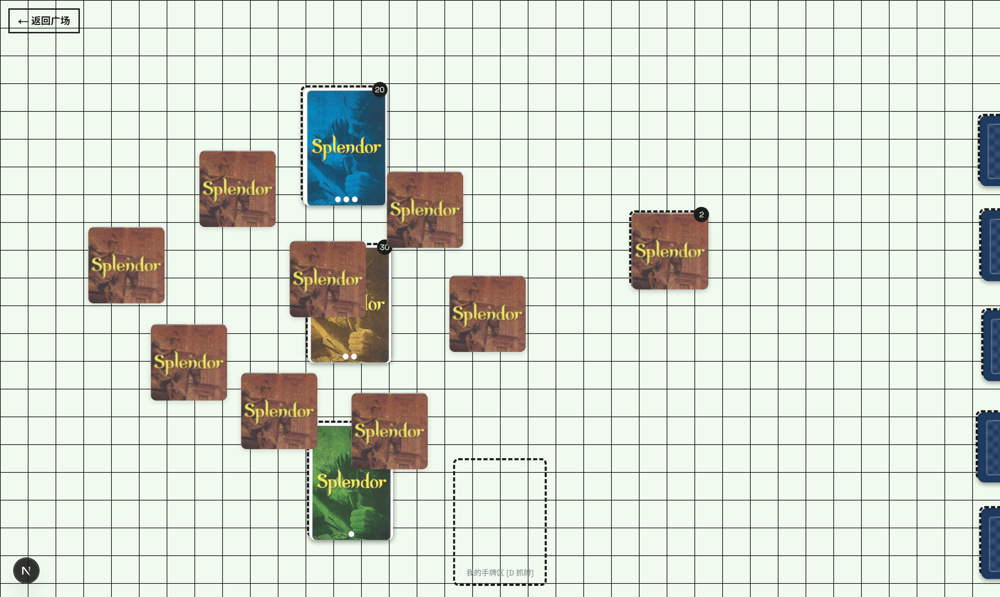
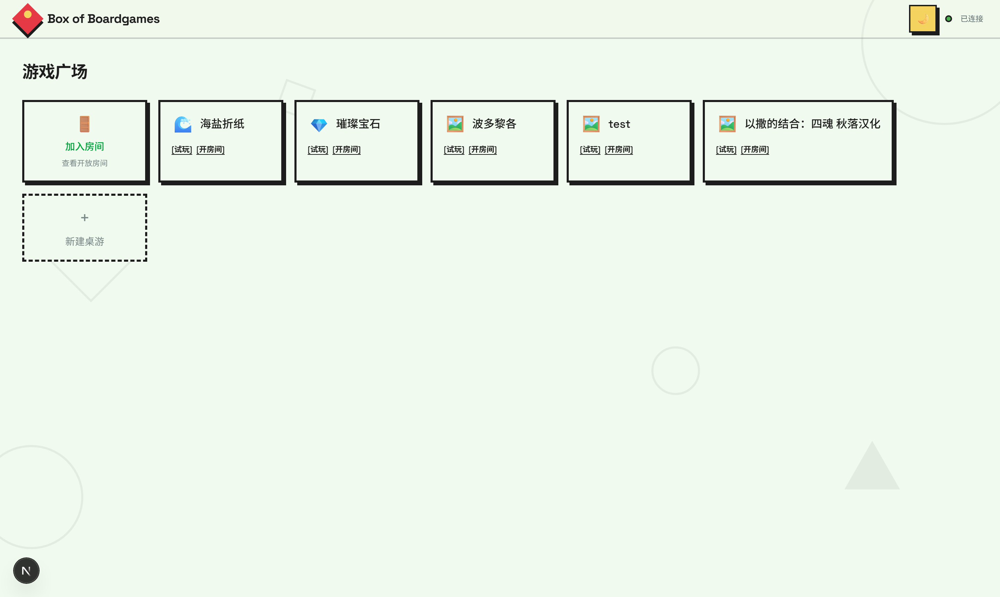

# BOB — Box of Boardgames

网页桌游沙盒。上传 PDF 生成卡牌资产，在浏览器里拖拽游玩，支持局域网多人联机。





## 功能

- 卡牌操作：拖放、翻面、洗牌、翻整叠、抓入手牌
- 堆叠：两张牌重叠合成牌堆，同尺寸牌堆可合并
- 手牌区：自己的展开在底部，其他玩家折叠在顶部
- 桌游导入：上传 PDF，按网格裁切生成卡牌，存入桌游库
- 座位：手动入座与离座，上限 6 人，手牌跟着座位走
- 多人联机：房间码创建与加入，状态实时同步，断线自动重连并恢复
- 资产分离：卡牌图片进房时一次加载，状态同步只带状态
- 桌面视图：滚轮缩放、空白处拖拽平移，拖拽中的实体置顶
- 组装工作台 `/lab`：导入 PDF、手绘实体、在现有桌游上修改、保存草稿
- 手绘实体：画笔、填色、橡皮、撤销；贴纸支持 emoji 与本地图片
- 实体类型：卡牌可翻可叠，Token 单面可叠，版图可旋转不可叠
- 计分与预设：玩家面板计分；当前桌面可存为预设，房间内一键加载

规则判定不实现，玩家自行遵守。

## 快速开始

```bash
npm install
npm run dev       # Next 页面与 ws 同进程，http://localhost:3000
```

打开 `http://localhost:3000`，输入昵称进入游戏广场，可导入 PDF、单机试玩或创建房间。

## 技术栈

- Next.js 16（App Router）+ TypeScript + Tailwind CSS v4
- `@dnd-kit/core`：拖拽
- `ws`：WebSocket 游戏服，与 Next 同端口，`/ws` 路径分发
- `pdfjs-dist`：PDF 渲染
- `zod`：数据校验

## 项目结构

```
bob/
├── app/
│   ├── layout.tsx                   # 根布局，WS 连接生命周期
│   ├── login/                       # 昵称登录页
│   ├── (main)/                      # 带顶部导航的页面组
│   │   ├── games/                   # 游戏广场：桌游列表、导入、开房加房
│   │   └── import/                  # PnP PDF 导入页
│   └── (game)/                      # 全屏页面组
│       ├── game/[gameId]/play/      # 单机试玩
│       ├── game/[gameId]/room/      # 创建房间中转页
│       └── room/[code]/             # 多人对局房间
├── components/
│   ├── game/                        # Card / CardBack / Pile / GameBoard / GameControlPanel
│   ├── lobby/                       # WsConnection / JoinRoomCard
│   └── room/                        # RoomPanel
├── lib/
│   ├── engine/                      # 引擎纯函数：types / actions / layout / build-game
│   │   └── card-action/             # 悬停快捷键交互
│   ├── pnp/                         # PDF 渲染与网格裁切
│   ├── assets/                      # 卡牌资产内存缓存
│   └── multiplayer/                 # connection / protocol / session / transport
└── server/                          # index 入口 / internal-api / game-ws / handlers / room-manager / game-library
```

## 设计要点

- 引擎为纯函数层 `lib/engine`，不依赖 UI，客户端与服务端共用
- 动作注册表 `lib/engine/reducers.ts` 统一分发，GameBoard 与服务端共用
- 服务端按顺序应用动作，广播全量状态
- 单进程单端口：`server/index.ts` 同时服务页面与 ws，客户端同源回退到 `/ws`

## 待办

- 卡牌横放（旋转 90°）
- 骰子
- 整理手牌顺序
- 一次选中多张卡牌移动
- 版图任意角度旋转
- 六边形网格桌游
- 桌面配色主题
- 打包（网页版 / 桌面版）
- 翻面 3D 动画
- 卡牌堆叠的视觉层次
- 手牌超过 7 张时的半遮盖模式
- 秘密信息与可见性
- 卡牌与 Token 互相叠放

## 相关文档

| 文档 | 内容 |
|------|------|
| [AGENTS.md](AGENTS.md) | 协作规范：角色检查、需求格式、硬性规则 |
| [docs/architecture.md](docs/architecture.md) | 架构地图：分层与关键机制 |
| [docs/practices.md](docs/practices.md) | 协作实践：讨论循环、角色方法 |
| [docs/notes/](docs/notes/) | 决策记录 |
